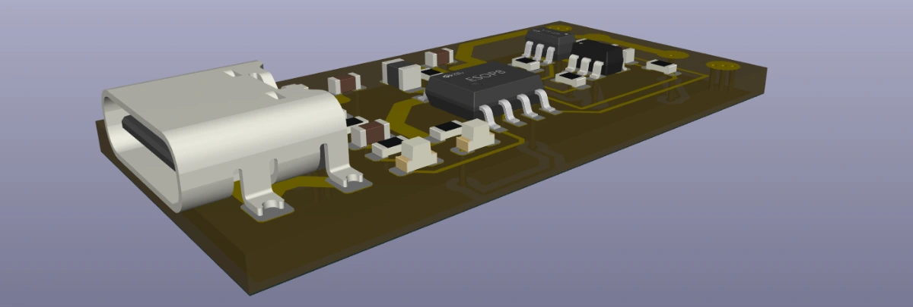
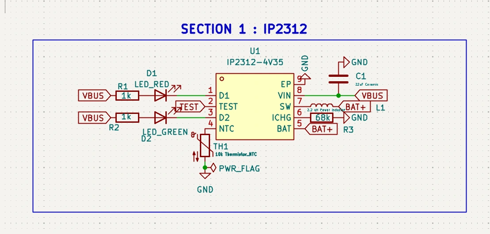
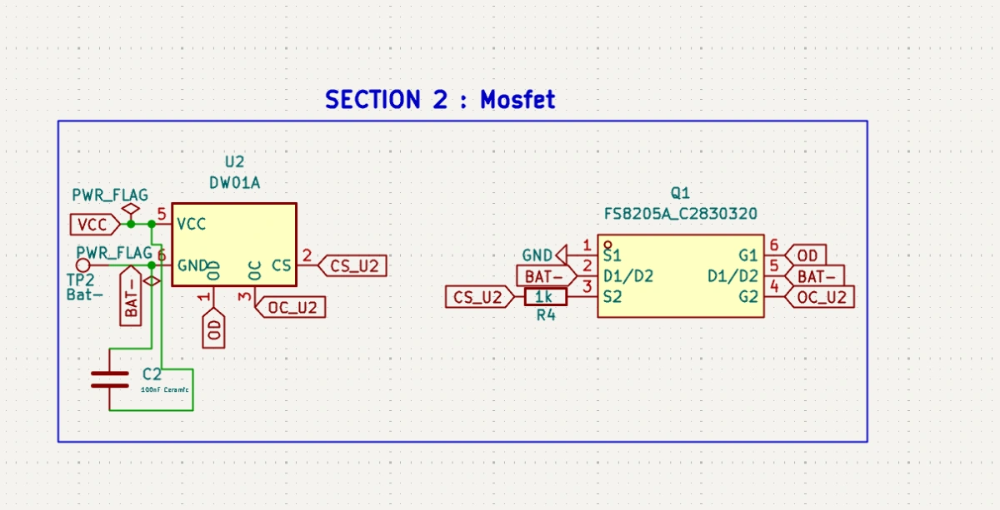
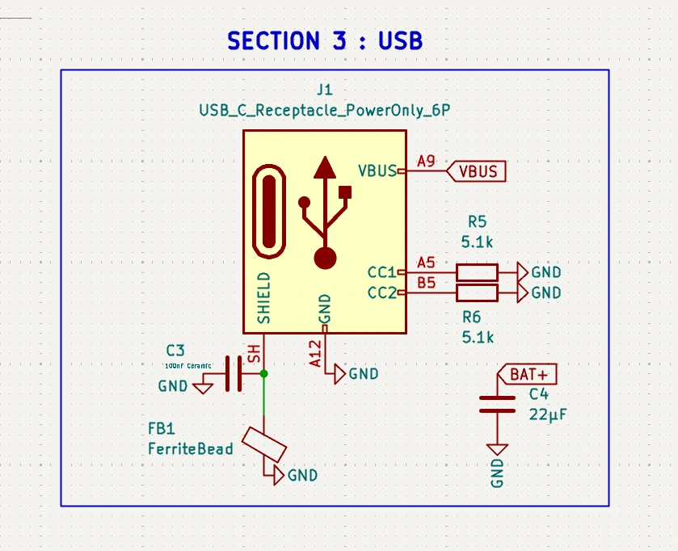
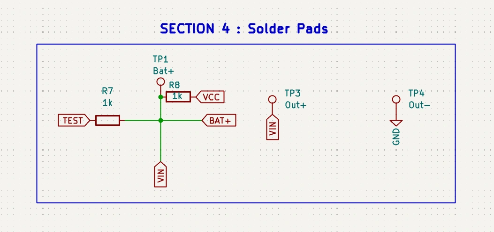
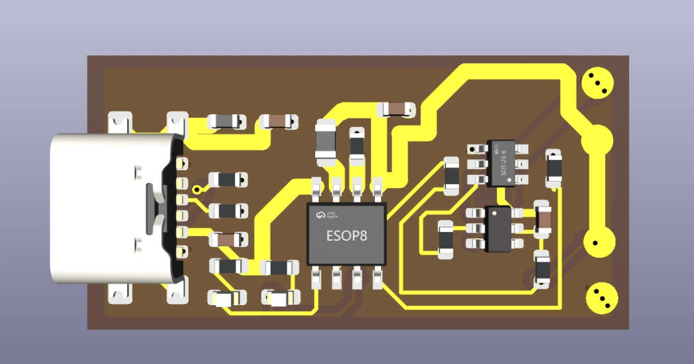
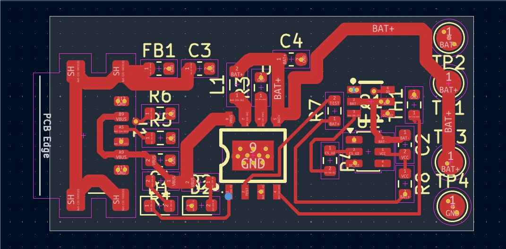
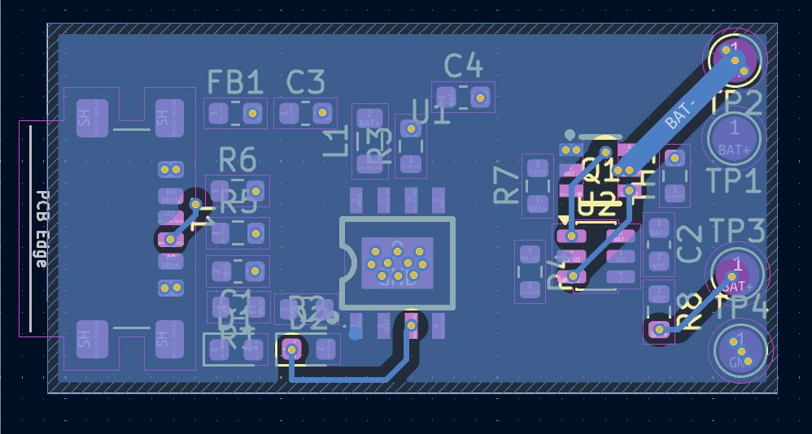

2# Li-Ion-Charger
Custom lithium ion charger that is small and does not blow up.

**The Problem** : In Indian market especially, TP4050 is available to charge lithium ion battery, but it sucks as it slowly damages the cell. But there are bigger alternatives which safely charge it. Buy those are bulky. This *Custom Li Ion charger* solves that.

# Features

1. 2A+ charging so you can charge with normal chargers.
2. Type C only.
3. Status LEDs (Red 🍒 - Charging, Green 🍏 - Charged)
4. Over Current protection with Mosfets

# BOM

| Ref | Value / Part | Description | JLCPCB Part # | Footprint | Qty | Unit Price (USD) | Total Price (USD) |
|-----|--------------|-------------|---------------|-----------|-----|------------------|-------------------|
| U1 | IP2312-4V35 | Switch-mode Li-ion charger IC, ESOP-8 | C605433 | `easyeda2kicad:ESOP-8_L4.9-W3.9-P1.27-LS6.0-BL-EP` | 1 | $0.3245 | $0.3245 |
| U2 | DW01A | Battery protection IC, SOT-23-6 | C351410 | `Package_TO_SOT_SMD:SOT-23-6` | 1 | $0.0418 | $0.0418 |
| Q1 | FS8205A | Dual N-channel MOSFET, SOT-23-6 | C55488492 | `Custom_Footprints:SOT-23-6_L2.9-W1.6-P0.95-LS2.8-BR` | 1 | $0.0483 | $0.0483 |
| L1 | 2.2 µH | Power inductor, ≥3A saturation | C515383 | `Inductor_SMD:L_0805_2012Metric` | 1 | ~$0.16 | ~$0.16 |
| C1 | 22 µF | Ceramic capacitor, input decoupling | C594231 | `Capacitor_SMD:C_0603_1608Metric` | 1 | ~$0.04 | ~$0.04 |
| C2 | 100 nF | Ceramic capacitor, DW01A bypass | C1590 | `Capacitor_SMD:C_0603_1608Metric` | 1 | ~$0.01 | ~$0.01 |
| C3 | 100 nF | Ceramic capacitor, shield bypass | C1590 | `Capacitor_SMD:C_0603_1608Metric` | 1 | ~$0.01 | ~$0.01 |
| C4 | 22 µF | Ceramic capacitor, output decoupling | C594231 | `Capacitor_SMD:C_0603_1608Metric` | 1 | ~$0.04 | ~$0.04 |
| R1 | 1 kΩ | LED current limit (Red) | C21190 | `Resistor_SMD:R_0603_1608Metric` | 1 | ~$0.01 | ~$0.01 |
| R2 | 1 kΩ | LED current limit (Green) | C21190 | `Resistor_SMD:R_0603_1608Metric` | 1 | ~$0.01 | ~$0.01 |
| R3 | 68 kΩ | ICHG set resistor (≈2A) | C25835 | `Resistor_SMD:R_0603_1608Metric` | 1 | ~$0.01 | ~$0.01 |
| R4 | 1 kΩ | CS current sense resistor | C21190 | `Resistor_SMD:R_0603_1608Metric` | 1 | ~$0.01 | ~$0.01 |
| R5 | 5.1 kΩ | CC1 pull-down | C23186 | `Resistor_SMD:R_0603_1608Metric` | 1 | ~$0.01 | ~$0.01 |
| R6 | 5.1 kΩ | CC2 pull-down | C23186 | `Resistor_SMD:R_0603_1608Metric` | 1 | ~$0.01 | ~$0.01 |
| R7 | 1 kΩ | TEST pin resistor | C21190 | `Resistor_SMD:R_0603_1608Metric` | 1 | ~$0.01 | ~$0.01 |
| R8 | 1 kΩ | VCC resistor for DW01A | C21190 | `Resistor_SMD:R_0603_1608Metric` | 1 | ~$0.01 | ~$0.01 |
| D1 | LED_RED | Charging indicator | C2286 | `LED_SMD:LED_0603_1608Metric` | 1 | ~$0.04 | ~$0.04 |
| D2 | LED_GREEN | Charge complete indicator | C72043 | `LED_SMD:LED_0603_1608Metric` | 1 | ~$0.04 | ~$0.04 |
| FB1 | Ferrite bead | 120Ω @ 100MHz, shield filter | C25415 | `Inductor_SMD:L_0603_1608Metric` | 1 | ~$0.03 | ~$0.03 |
| J1 | USB_C_Receptacle_PowerOnly_6P | USB-C power-only connector | C52209103 | `Connector_USB:USB_C_Receptacle_GCT_USB4135-GF-A_6P_TopMnt_Horizontal` | 1 | $0.2985 | $0.2985 |
| TH1 | 10 kΩ NTC | Thermistor for temperature sensing | C71322 | `Resistor_SMD:R_0603_1608Metric` | 1 | ~$0.03 | ~$0.03 |
| TP1 | TestPoint | Bat+ | N/A (PCB feature) | `TestPoint:TestPoint_Pad_D2.0mm` | 1 | $0.00 | $0.00 |
| TP2 | TestPoint | Bat− | N/A (PCB feature) | `TestPoint:TestPoint_Pad_D2.0mm` | 1 | $0.00 | $0.00 |
| TP3 | TestPoint | Out+ | N/A (PCB feature) | `TestPoint:TestPoint_Pad_D2.0mm` | 1 | $0.00 | $0.00 |
| TP4 | TestPoint | Out− | N/A (PCB feature) | `TestPoint:TestPoint_Pad_D2.0mm` | 1 | $0.00 | $0.00 |

# Schematic 

# PCB 

# Credits 
Ki Cad for PCB design, downloaded some footprints through easy eda plugin (thanks to who ever made this). And used this for compression of screenshots (made by me btw).
https://ilovefilesbyhemanth.netlify.app/

# AI Usage 
Used AI for understanding datasheets and verifying components.

# Licence

Free to use gerbers and all, but not yet tested. Feel free to modify it. but don't burn your house :)

